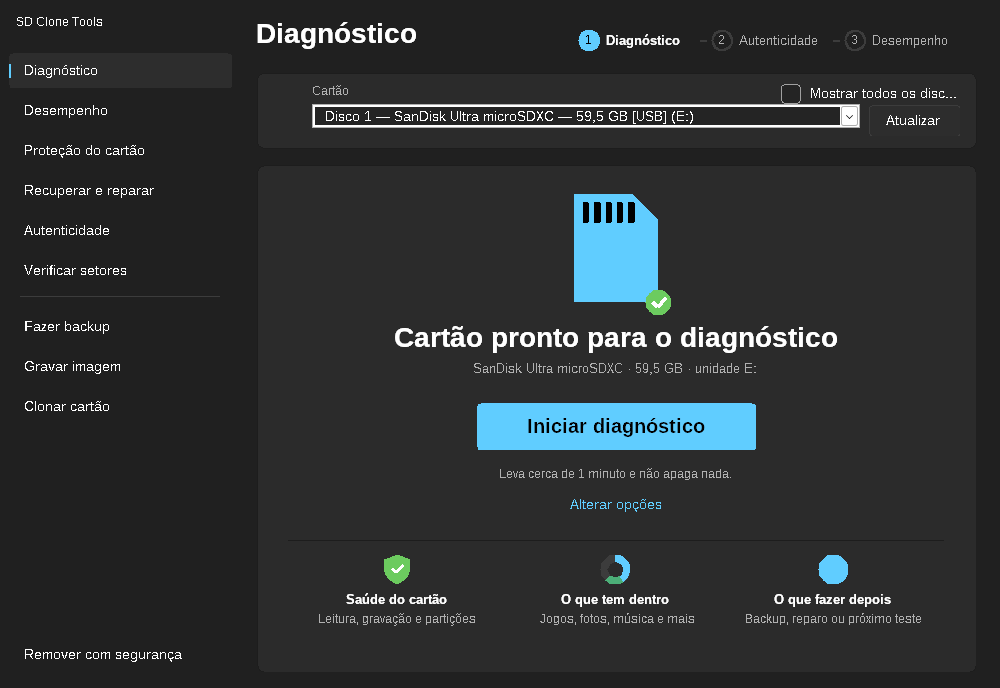
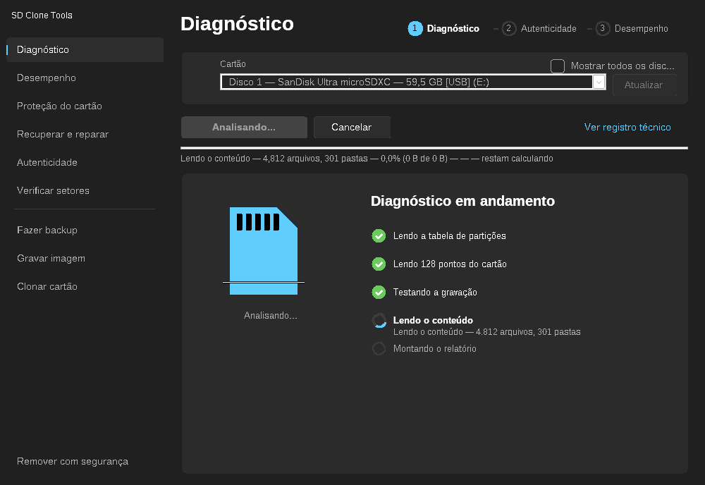
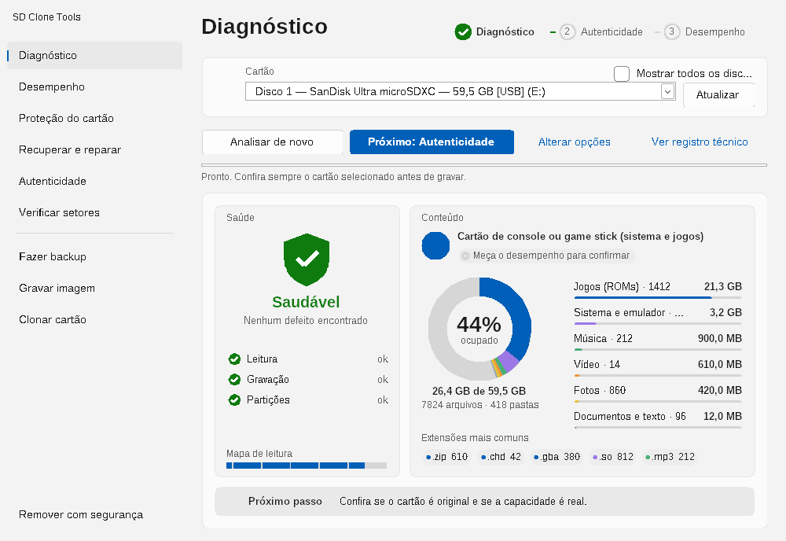
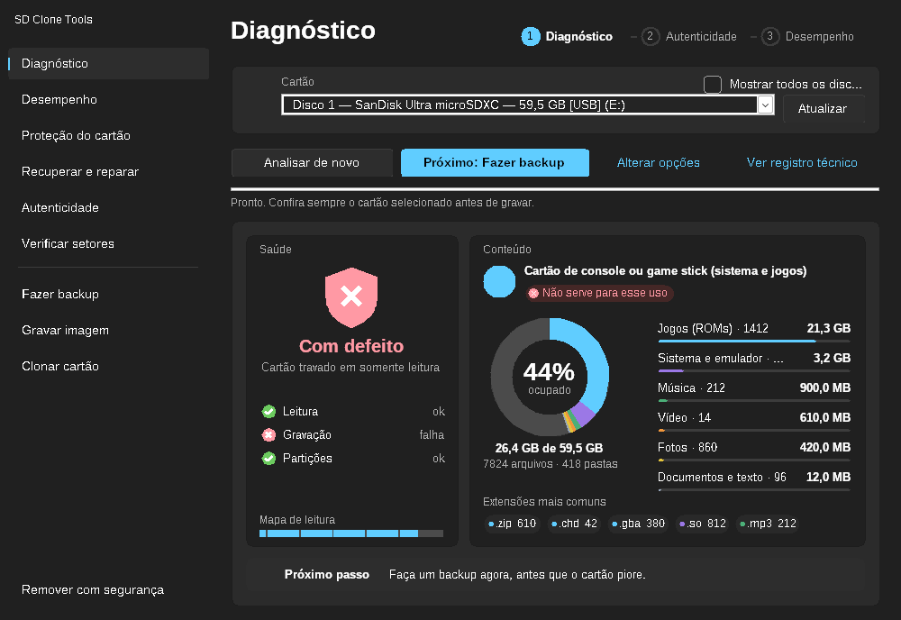
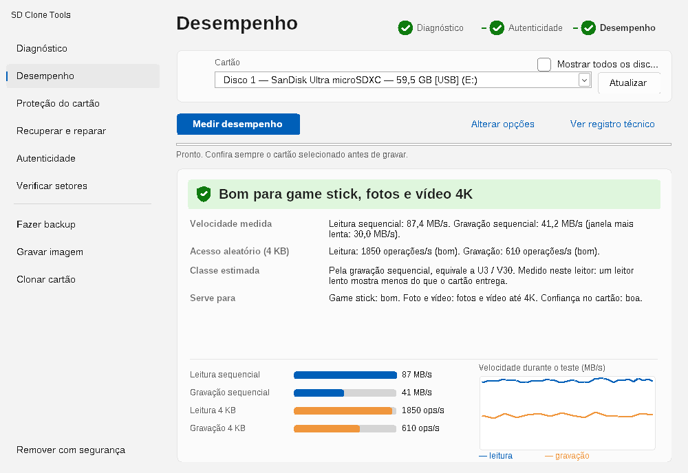
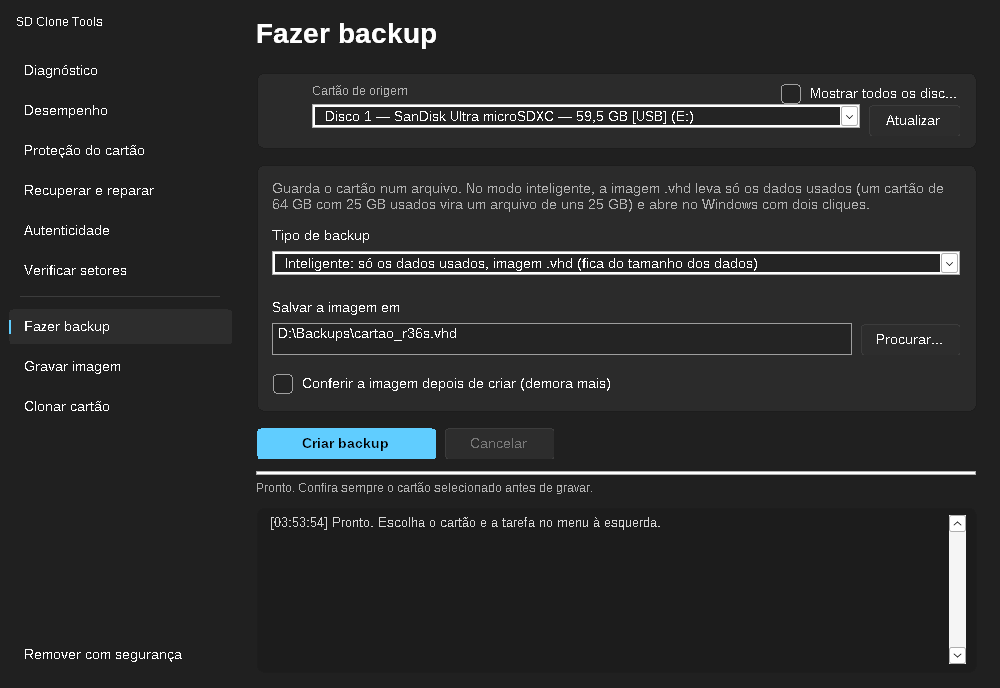
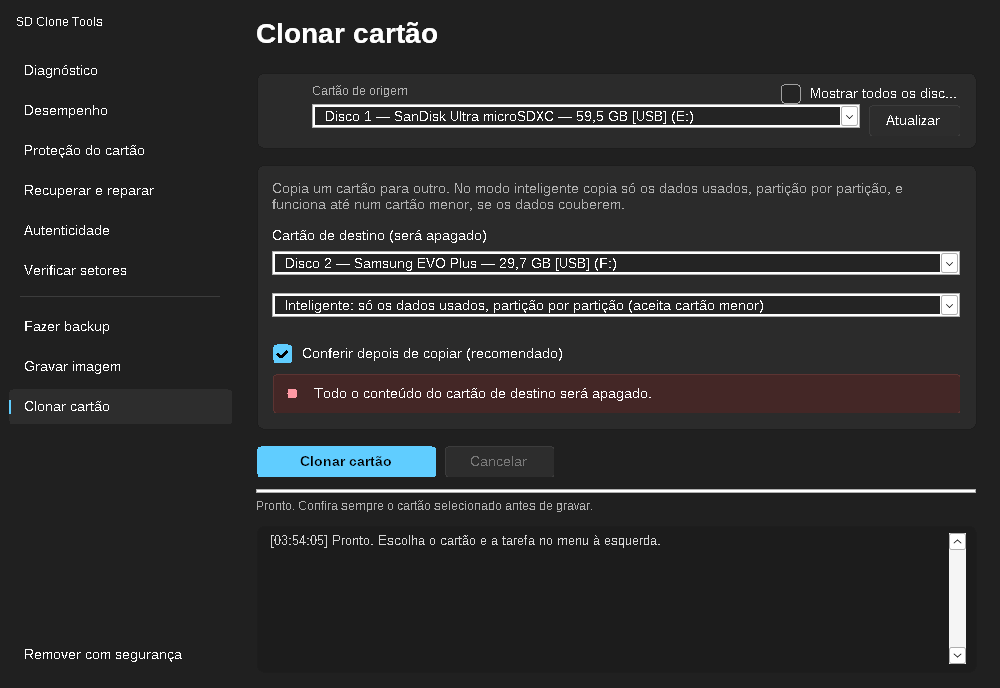

# SDCLONETOOLS

**Ferramenta gratuita e de código aberto para Windows para quem trabalha com cartões SD em gamesticks e consoles portáteis chineses.**

Quem monta, grava e conserta esses aparelhos (R36S e clones, M17, gamesticks e similares) vive com cartões SD: gravar o sistema, clonar o cartão que já está configurado, fazer backup, recuperar o que sumiu e, principalmente, descobrir se o cartão que veio na caixa é mesmo o que diz ser. O SDCLONETOOLS junta tudo isso em **um único `.exe`**, sem instalação, sem anúncios e sem dependências.

## Download

[**⬇ Baixar SDCloneTools.exe (Windows 64 bits)**](https://github.com/emersoncassis/SDCLONETOOLS/releases/latest/download/SDCloneTools.exe)

[Baixar SDCloneTools32.exe (Windows 32 bits)](https://github.com/emersoncassis/SDCLONETOOLS/releases/latest/download/SDCloneTools32.exe) · [Todas as versões](https://github.com/emersoncassis/SDCLONETOOLS/releases)

Arquivo único, sem instalação. Execute e aceite o pedido de administrador.

## Telas

**1. Tela inicial**: o cartão encontrado e um botão para começar. A trilha no topo mostra a jornada Diagnóstico → Autenticidade → Desempenho.



**2. Diagnóstico em andamento**: cada etapa ganha um visto quando termina.



**3. Resultado**: saúde à esquerda (escudo verde, laranja ou vermelho) e conteúdo à direita (gráfico do que tem dentro, tipo de uso e se o cartão serve para ele). Embaixo, o próximo passo.



Cartão com defeito: o próximo passo vira backup.



**4. Desempenho**: velocidades medidas, gráfico durante o teste e para que o cartão serve.



**Backup e clone inteligentes**: escolha o tipo na própria tela.





**Proteção do cartão**: dois modos separados, leitor interno do computador ou Arduino/ESP32.


> As telas acima foram geradas com dados de exemplo (`--demo`).

## Como usar (a jornada)

1. Abra o app. A tela inicial já mostra o cartão encontrado e o botão **Iniciar diagnóstico** (com mais de um cartão, escolha na lista). Conectou outro cartão? O app seleciona ele sozinho.
2. Durante a análise, a tela mostra cada etapa sendo feita e o mapa de leitura se preenchendo.
3. O resultado vem numa página só: **saúde** (escudo verde, laranja ou vermelho, com leitura, gravação e partições) e **conteúdo** (gráfico de rosca com o que tem dentro, tipo de uso e se o cartão serve para ele).
4. O botão **Próximo** leva ao passo seguinte: **Autenticidade** e depois **Desempenho**. A trilha no topo marca o que já foi feito. Se o cartão tiver defeito, o próximo passo vira backup ou reparo.

Para ver as telas sem mexer em nenhum cartão: `SDCloneTools.exe --demo=hero` (também `busy`, `diag`, `diagbad`, `bench`, `auth`).

## O que faz

| Função | Para que serve |
|---|---|
| **Diagnóstico** | Analisa o cartão sem apagar nada: tabela de partições, leitura em 128 pontos, teste opcional de gravação (grava 4 KB em 2 pontos e devolve o conteúdo original) e leitura do registro CID. Mostra numa página só a **saúde** (escudo com leitura, gravação e partições) e o **conteúdo**: quanto do cartão está ocupado, em gráfico, os tipos de arquivo (jogos, sistema e emulador, música, vídeo, fotos, documentos...), as extensões mais comuns, o tipo de uso do cartão (game stick, câmera, música...) e se ele serve para esse uso. Termina com o próximo passo |
| **Desempenho** | Mede leitura e gravação sequencial e de 4 KB, mostra a velocidade durante o teste e diz se o cartão é bom para game stick, para fotos e vídeo (Full HD/4K) ou se é um cartão genérico em que não dá para confiar |
| **Proteção do cartão** | Lê os bits de proteção contra gravação (CSD) e o bloqueio por senha, para saber se o cartão está travado por proteção ou pelo firmware. Tem dois modos, descritos abaixo |
| **Recuperar e reparar** | Análise de partições, ver e copiar arquivos (inclusive ext4 de consoles), reconstruir partições perdidas sem apagar dados, procurar arquivos apagados (de uma imagem ou do cartão) e restaurar o cartão |
| **Autenticidade** | Descobre se o cartão é verdadeiro ou falso: marca, fabricante registrado, capacidade real e velocidade |
| **Verificar setores** | Leitura completa, comparação com uma imagem e teste de capacidade real |
| **Fazer backup** | **Inteligente**: imagem `.vhd` só com os dados usados (cartão de 64 GB com 25 GB usados vira um arquivo de ~25 GB, que o Windows abre com dois cliques). Ou cópia exata setor a setor em `.img` |
| **Gravar imagem** | Grava `.vhd`, `.img`, `.iso` ou `.bin` no cartão, com conferência. Imagem maior que o cartão também vai, se os dados couberem |
| **Clonar cartão** | **Inteligente**: copia só os dados usados, partição por partição, e aceita cartão menor (64 GB com 25 GB usados → cartão de 32 GB). Ou cópia exata setor a setor |

### Proteção do cartão: dois modos

| | Leitor interno do computador | Arduino ou ESP32 por USB |
|---|---|---|
| Serve para | Slot de cartão SD do notebook/PC | Qualquer cartão micro SD, com um módulo de ~R$ 10 |
| Leitor USB | Não funciona (leitores USB não repassam comandos ao cartão) | Não depende do leitor do PC |
| O que faz | Só lê o CID, o CSD e o estado de bloqueio | Lê os registros, testa gravação direto no cartão e pode desligar a proteção **temporária** |
| Instalação | Nenhuma | Gravar o programa em [`arduino/`](arduino/LEIA.md) na placa |

No modo Arduino, o app lista as portas USB, marca as que parecem Arduino ou ESP32 e confirma que a placa tem o programa do SD Clone Tools antes de começar. O resultado diz se o bloqueio é proteção temporária, proteção permanente, senha ou **firmware travado em somente leitura** (o cartão recusa gravar mesmo sem nenhum bit ligado; não há conserto por software, só salvar os dados). Se o cartão grava normalmente direto no Arduino, o defeito está no leitor ou adaptador do computador. A ligação dos fios e o passo a passo estão em [arduino/LEIA.md](arduino/LEIA.md).

### Backup e clone inteligentes (como o Acronis)

Como no Acronis, a cópia é feita **partição por partição, só com os blocos que o sistema de arquivos usa**:

- **FAT16/FAT32, exFAT e ext2/3/4** (Linux dos consoles): o app lê o mapa de blocos usados de cada partição e copia só eles. Partições de outro tipo (NTFS, desconhecidas) vão inteiras.
- A área antes da primeira partição (tabela e **carregador de boot** dos consoles, como o do R36S) e os pequenos espaços entre partições vão sempre.
- **Destino menor**: a última partição é reduzida para caber, sem mover dados, desde que todos os dados usados caibam (FAT16, FAT32 e exFAT, que é o caso da partição de ROMs). A tabela MBR ou GPT é ajustada. Se não couber, o app diz o tamanho mínimo e não grava nada. Partição Linux (ext4) no fim não pode ser reduzida, e o app explica.
- **Backup em `.vhd` dinâmico**: só os blocos gravados ocupam espaço no arquivo. O Windows abre o `.vhd` com dois cliques (Montar) para você ver os arquivos, e o **Gravar imagem** devolve ele a um cartão do mesmo tamanho, maior ou menor.
- Com **Conferir** marcado, tudo o que foi gravado é relido e comparado com a origem.

Testado em Linux com cartões montados de verdade (MBR e GPT; FAT32, ext4 e exFAT): reduções de 1200 MB para 900 MB passam no `fsck.vfat`, `e2fsck`, `fsck.exfat` e `sfdisk --verify`, todos os arquivos conferem byte a byte, e o `.vhd` é lido pelo `qemu-img` (veja `tests/run_smart.py`).

### Cartão de 128 GB aparecendo com poucos MB? Cartão "sem acesso"?

Use **Diagnóstico**, depois **Recuperar e reparar**. O app lê o cartão sem alterar nada e diz qual é o caso:

- **o próprio cartão informa pouca capacidade** (controlador com defeito ou cartão falso): não é partição, não tem conserto por software comum, e o app explica isso;
- **partições cobrindo só parte do cartão** (imagem pequena gravada em cartão grande): os dados estão intactos e o espaço pode ser recuperado;
- **partições Linux que o Windows não lê** (normal em R36S, ArkOS, JELOS): o app abre e copia esses arquivos;
- **tabela de partições apagada** (cartão "RAW"): o app encontra as partições e reconstrói a tabela sem apagar nada;
- **cartão que não aceita gravação** (erro de E/S 1117 ao formatar): firmware em modo somente leitura, comum em cartão desgastado. Leitura ainda funciona, então o app orienta a fazer o backup primeiro.

### Por que a Autenticidade importa

Cartão falso (um cartão de 8 GB que se anuncia como 128 GB, por exemplo) é comum em kits e aparelhos baratos. Ele grava e lê normalmente até o espaço real acabar, e depois corrompe os dados em silêncio. O SDCLONETOOLS:

- lê o **fabricante gravado no cartão** (registro CID) e compara com a marca da etiqueta (SanDisk, Samsung, Kingston, Lexar, Sony, Transcend, ADATA...);
- faz o **teste de capacidade real**: grava dados em todo o cartão e confere se voltam idênticos;
- compara a velocidade medida com a **classe anunciada** (Class 10, U1, U3, V30...).

> O chip de memória (NAND) em si não fica registrado no cartão, então nenhum software consegue dizer quem o fabricou. A ferramenta identifica o fabricante/etiqueta do cartão, e o teste de capacidade mostra se ele entrega o que promete.

## Download e uso rápido

1. [Baixe o `SDCloneTools.exe`](https://github.com/emersoncassis/SDCLONETOOLS/releases/latest/download/SDCloneTools.exe) (use o `SDCloneTools32.exe` apenas em Windows de 32 bits).
2. Execute e aceite o pedido de **administrador** (necessário para acessar o disco direto).
3. Escolha a função, o cartão e clique em **Iniciar**.

O guia completo, função por função, está em [docs/USO.md](docs/USO.md).

## Segurança

- O disco do sistema **nunca aparece** na lista, e por padrão só aparecem cartões e discos removíveis.
- Toda operação que grava mostra o disco escolhido e pede confirmação. **Confira o disco antes de confirmar.**
- **Teste com um cartão sem dados importantes antes de usar no dia a dia.** Este é um software novo.
- O Windows SmartScreen ou o antivírus podem alertar, porque o programa acessa o disco diretamente e não tem assinatura digital. Todo o código-fonte está neste repositório, e você pode compilar o seu próprio `.exe` (veja abaixo).

## Compilar

C puro com a API Win32, sem dependências. Precisa de Python e do compilador Zig (`pip install ziglang`); funciona a partir de Linux, macOS ou Windows:

```sh
./build.sh
```

Isso gera `SDCloneTools.exe` (64 bits) e `SDCloneTools32.exe`.

Testes automatizados (em Linux):

```sh
gcc -O1 -o test_core test_core.c && ./test_core   # recuperação de arquivos apagados
sudo python3 tests/run_tests.py                    # leitores de FAT/exFAT/ext4 e diagnóstico (imagens reais)
```

O segundo precisa de `dosfstools mtools exfatprogs exfat-fuse e2fsprogs fdisk`.

## Estrutura

| Arquivo | Conteúdo |
|---|---|
| `sdclone.c` | Interface Win32 e operações de disco |
| `smart.h` | Cópia inteligente: blocos usados por partição (FAT, exFAT, ext), plano de cópia, redução de FAT/exFAT e ajuste de MBR/GPT |
| `vhd.h` | Leitura e gravação de `.vhd` dinâmico |
| `usage.h` | Conteúdo do cartão: ocupação, tipos de arquivo e perfil de uso (sem Windows, testado em Linux) |
| `bench.h` | Julgamento do teste de desempenho (sem Windows) |
| `arduino/` | Programa para Arduino/ESP32 e guia de ligação (modo Arduino da Proteção do cartão) |
| `core.h` | Motor de recuperação, padrão do teste de capacidade e tabela de fabricantes |
| `fsread.h` | Leitura somente leitura de FAT12/16/32, exFAT e ext2/3/4 |
| `diag.h` | Diagnóstico de MBR/GPT, partições perdidas e reconstrução do MBR |
| `repair.h` | Diagnóstico, reconstrução e navegador de arquivos na interface |
| `test_core.c`, `fstest.c`, `tests/` | Testes automatizados |
| `sdclone.rc`, `sdclone.manifest`, `sdclone.ico`, `mkicon.py` | Ícone e manifesto (exige administrador) |
| `build.sh` | Script de compilação |
| `docs/USO.md` | Guia de uso completo |

## Contribuir

Contribuições são muito bem-vindas: relatos de cartões testados, novos fabricantes na tabela, correções e traduções. Veja [CONTRIBUTING.md](CONTRIBUTING.md).

## Licença

[MIT](LICENSE). Use, modifique e distribua à vontade.

## Aviso

Este software acessa dispositivos de armazenamento diretamente e é fornecido **sem garantia de qualquer tipo**. Use por sua conta e risco e mantenha backup do que importa.
